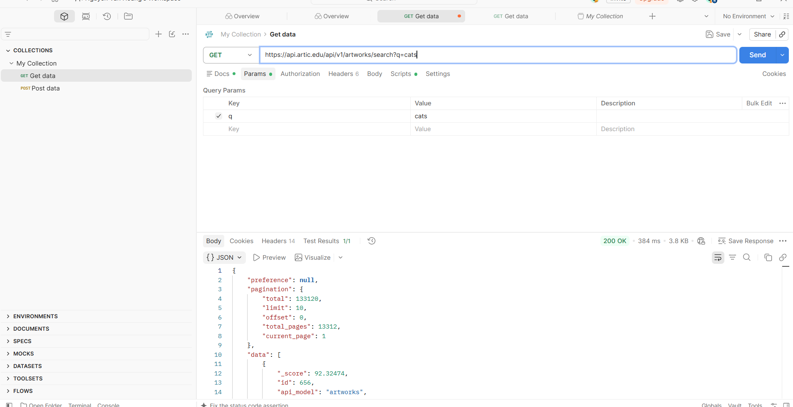
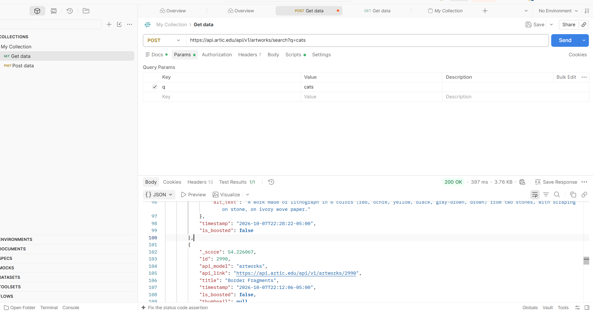
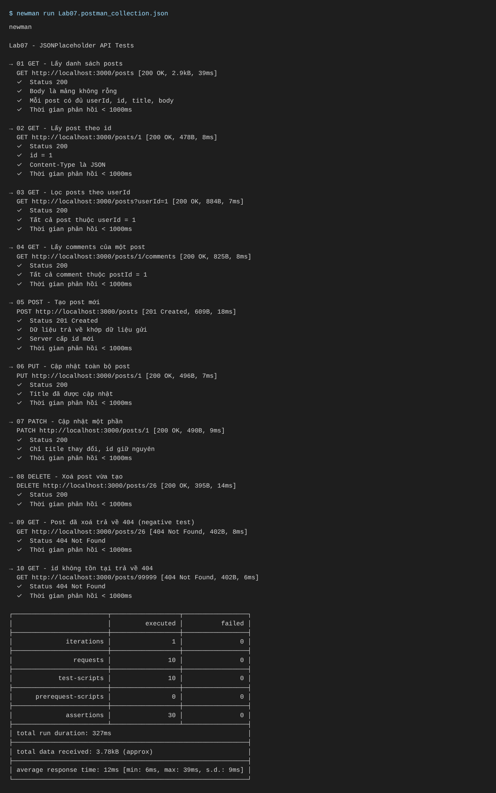
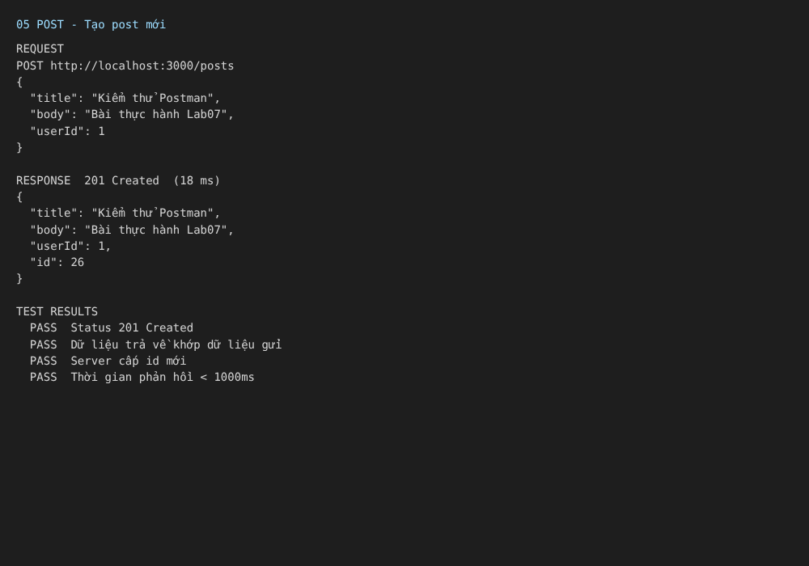
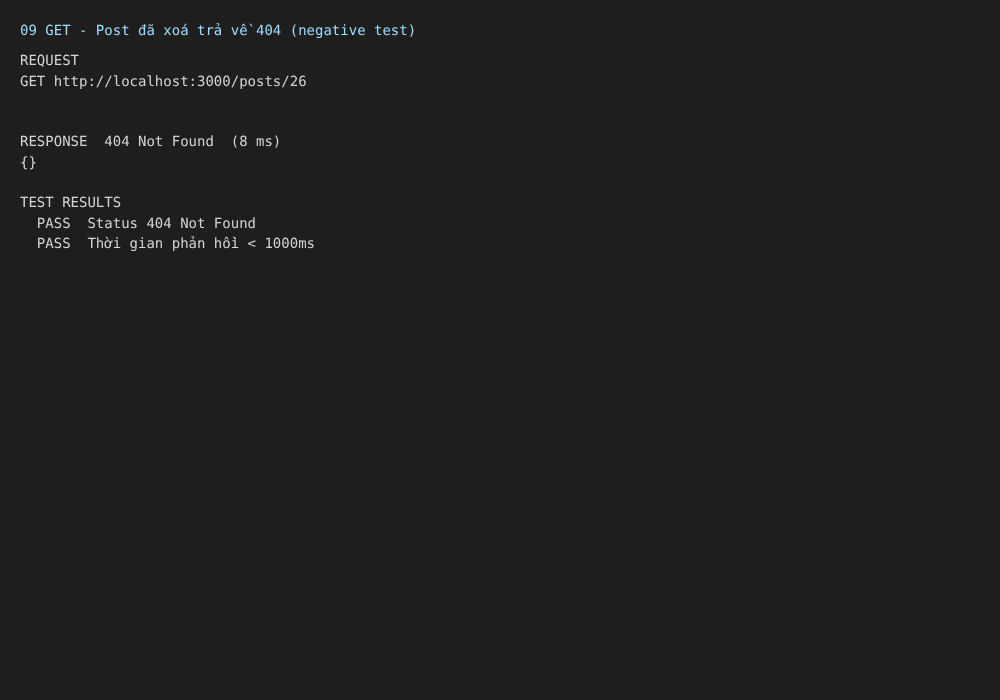

# Lab 07 – Kiểm thử API với Postman

**Sinh viên:** Nguyễn Văn Hoàng – MSSV 23010101 · **Môn:** Kiểm định chất lượng phần mềm

## 1. Mục tiêu

Làm quen Postman: tạo request, dùng biến, viết test script (`pm.test`) và chạy cả collection bằng Newman.

Tài liệu tham khảo: [video hướng dẫn](https://www.youtube.com/watch?v=MFxk5BZulVU) · [Postman – Test scripts](https://learning.postman.com/docs/tests-and-scripts/write-scripts/test-scripts/) · [Newman](https://github.com/postmanlabs/newman)

## 2. Thực hành trên Postman (API thật)

API: Art Institute of Chicago. Request: `GET https://api.artic.edu/api/v1/artworks/search?q=cats` (tham số `q = cats`).



Kết quả: **200 OK**, 384 ms, 3.8 KB, Test Results **1/1**. Response có `pagination` (`total = 133120`, `limit = 10`) và mảng `data` gồm 10 tác phẩm sắp theo `_score` giảm dần.

Thử đổi phương thức sang **POST** với cùng URL và tham số `q = cats`:



Kết quả: **200 OK**, 397 ms, 3.76 KB, Test Results **1/1**. Response có cùng cấu trúc với GET (`pagination.total = 133120`, `limit = 10`, 10 tác phẩm); thứ tự và `_score` chênh nhẹ so với lần GET (ví dụ `id = 656` có `_score` 92.92 so với 92.32).

## 3. Bộ test tự động (Newman)

Collection `postman/Lab07.postman_collection.json` kiểm thử các thao tác CRUD trên `/posts` (biến `{{baseUrl}}`):

| # | Request | Kiểm tra chính |
|---|---------|----------------|
| 01–04 | GET (danh sách, theo id, lọc `userId`, comments) | 200, đúng cấu trúc và dữ liệu |
| 05 | POST `/posts` | 201, dữ liệu khớp, lưu `newPostId` |
| 06–07 | PUT, PATCH `/posts/1` | 200, trường được cập nhật |
| 08 | DELETE `/posts/{{newPostId}}` | 200 |
| 09–10 | GET post đã xoá / id không tồn tại | 404 (kiểm thử âm) |

Mọi request đều kiểm tra thêm thời gian phản hồi < 1000 ms.

> **Lưu ý:** môi trường chạy tự động không truy cập được `jsonplaceholder.typicode.com`, nên bộ test được chạy trên server cục bộ `json-server` (dữ liệu cùng cấu trúc, xem `mock-server/`). Muốn chạy API thật, chọn environment `jsonplaceholder.postman_environment.json`. Ảnh dưới đây là kết quả Newman, không phải giao diện Postman.

```bash
npx json-server@0.17.4 --watch mock-server/db.json --port 3000
newman run postman/Lab07.postman_collection.json -e postman/local-mock.postman_environment.json -r cli,htmlextra
```

**Kết quả: 10 request, 30 assertion, 0 thất bại**, thời gian phản hồi trung bình ~12 ms.







Các ảnh còn lại (báo cáo HTML, GET, PUT, DELETE) nằm trong `screenshots/`, báo cáo đầy đủ trong `reports/`.

## 4. Kết luận

Các request đáp ứng tiêu chí kiểm thử: đúng mã trạng thái, đúng cấu trúc JSON và đúng hành vi CRUD. Lần chạy đầu có 1 assertion lỗi do dùng regex sai trong kiểm tra header, đã sửa bằng `pm.expect(pm.response.headers.get("Content-Type")).to.include("application/json")`.
